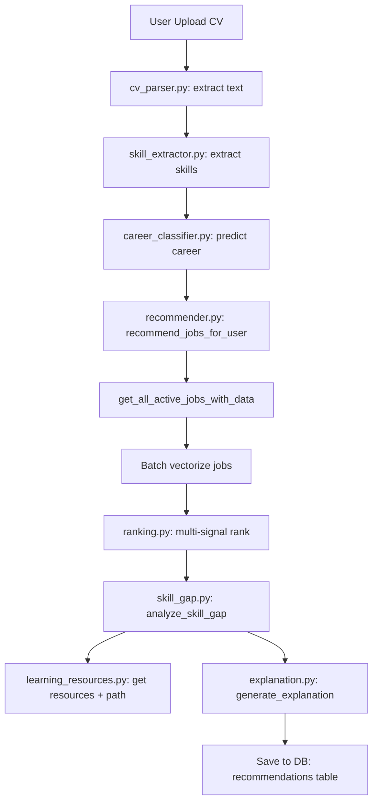

# 🧠 AI Modules Documentation

Tài liệu chi tiết các module trong thư mục `ai/` của dự án **IT Career Match**.

---

## 📁 Cấu Trúc Thư Mục

```
ai/
├── __init__.py              # Public API exports (singleton instances)
├── career_classifier.py     # Logistic Regression + TF-IDF career prediction
├── skill_extractor.py       # Regex-based skill extraction (316 skills + aliases)
├── recommender.py           # Main recommendation engine (multi-signal)
├── skill_gap.py             # Enhanced skill gap analysis + learning path
├── learning_resources.py    # Free learning resource recommender (60+ skills)
├── skill_matcher.py         # Hybrid skill matching (exact + alias + semantic)
├── embeddings_cache.py      # Skill embeddings cache (Sentence Transformers)
├── ranking.py               # Multi-signal ranking engine
├── explanation.py           # Natural language explanations
├── match_score.py           # Match score calculation utilities
├── text_preprocessing.py    # Text cleaning & normalization
├── cv_parser.py             # PDF/DOCX text extraction
├── chatbot/
│   ├── __init__.py
│   └── engine.py            # Rule-based chatbot engine
└── test_career_model.py     # Model evaluation script
```

---

## 🔑 Module Details

### 1. `career_classifier.py` - Career Category Prediction

**Mục đích**: Phân loại CV thành 7 nhóm nghề IT.

| Thuộc tính | Giá trị |
|---|---|
| **Algorithm** | Logistic Regression (class_weight=balanced) |
| **Features** | TF-IDF (max_features=2000, ngram_range=(1,2)) |
| **Classes** | 7: AI/ML, Backend, Cybersecurity, Data, DevOps/Cloud, Network/System, Other IT |
| **Accuracy** | 83.64% (46/55 test samples) |
| **Model files** | `models/career_classifier.joblib`, `models/tfidf_vectorizer.joblib` |

**Class chính: `CareerClassifier`**
```python
from ai.career_classifier import get_classifier, CareerClassifier

# Sử dụng singleton (khuyến nghị)
clf = get_classifier()

# Hoặc tạo instance tùy chỉnh
clf = CareerClassifier(
    confidence_threshold=0.6,
    max_features=2000,
    ngram_range=(1, 2)
)

# Predict
career = clf.predict(cv_text)                    # str hoặc None
probas = clf.predict_proba(cv_text)              # Dict[str, float]
top_k = clf.predict_top_k(cv_text, k=3)          # List[{"career": str, "probability": float}]

# Train (CLI)
python -m ai.career_classifier data/career_preprocessed.csv
```

**Đặc điểm quan trọng:**
- **Lazy loading**: Model chỉ load khi gọi `predict()` lần đầu
- **Confidence threshold**: Mặc định 0.6, trả về `None` nếu confidence thấp
- **Technical acronyms preservation**: Giữ nguyên AI, ML, API, SQL, CI/CD... khi preprocessing

---

### 2. `skill_extractor.py` - Skill Extraction

**Mục đích**: Trích xuất kỹ năng từ text CV/JD bằng regex word-boundary matching.

**Data:**
- **SKILL_LIST**: 316 kỹ năng IT (categorized: Languages, Frontend, Backend, DB, Cloud, Mobile, Testing, Architecture, Security, Data/AI, Tools)
- **SKILL_ALIASES**: 150+ alias mapping (ts→typescript, k8s→kubernetes, ml→machine learning...)

**Hàm chính:**
```python
from ai.skill_extractor import extract_skills, SKILL_LIST, SKILL_ALIASES

skills = extract_skills(cv_text)
# Returns: sorted list of unique matched skill names

# Edge cases handled:
# - "javascript" KHÔNG match "java" (word boundary)
# - "c++" match chính xác (escape special chars)
# - "node.js" match "node.js" không match "node"
# - Aliases: "reactjs" → "react", "postgres" → "postgresql"
```

**Logic matching:**
1. Pre-compile regex patterns cho tất cả skills + aliases
2. Match từng pattern trên text lowercase
3. Deduplicate & sort kết quả

---

### 3. `recommender.py` - Main Recommendation Engine

**Mục đích**: Gợi ý việc làm cho user dựa trên CV + multi-signal ranking.

**Pipeline:**
```
User CV Text
    ↓
vectorize_cv() → TF-IDF vector
    ↓
predict_career() → Career Category
    ↓
get_all_active_jobs_with_data() → Jobs + skills + TF-IDF vectors (batch)
    ↓
RankingEngine.rank_jobs() → Multi-signal scoring
    ↓
analyze_skill_gap() → Matched/Missing skills + resources + learning path
    ↓
generate_explanation() → Human-readable reason
    ↓
save_recommendations() → Store in DB
```

**Hàm chính:**
```python
from ai.recommender import (
    recommend_jobs_for_user,    # Full pipeline cho user_id
    recommend_jobs,             # Legacy: từ raw CV text
    predict_career,             # Career prediction
    vectorize_cv,               # CV → TF-IDF vector
    get_user_skills,            # User skills từ DB
    get_all_active_jobs         # Active jobs từ DB
)

# Full recommendation cho user
recommendations = recommend_jobs_for_user(user_id=123, top_k=10)

# Mỗi recommendation chứa:
{
    "job_id": 456,
    "title": "Python Developer",
    "company": "TechCorp",
    "match_score": 87.5,           # 0-100 (similarity + career bonus)
    "skill_match": 75.0,           # % skills matched
    "career_match": True,          # Career category match
    "matched_skills": ["python", "sql", "docker"],
    "missing_skills": ["kubernetes", "aws"],
    "missing_skills_by_priority": ["kubernetes", "aws"],
    "skill_details": [...],        # SkillMatchDetail objects
    "resources": {...},            # Learning resources per missing skill
    "learning_path": {...},        # 3-phase learning path
    "explanation": {...},          # Generated explanation
    "predicted_career": "Backend Development",
    "career_predictions": [...]
}
```

**Multi-signal Ranking (từ `ranking.py`):**
| Signal | Weight | Mô tả |
|---|---|---|
| `tfidf_cosine` | 0.35 | Cosine similarity CV-JD |
| `skill_overlap` | 0.25 | Jaccard similarity skills |
| `career_bonus` | 0.20 | +30 points nếu career match |
| `salary_fit` | 0.10 | Match salary expectation |
| `recency` | 0.10 | Job mới hơn rank cao hơn |

---

### 4. `skill_gap.py` - Skill Gap Analysis v3

**Mục đích**: Phân tích chi tiết kỹ năng thiếu + priority + learning resources.

**Kết quả (`SkillGapResult`):**
```python
{
    "cv_skills": [...],
    "job_skills": [...],
    "matched_skills": ["python", "sql"],
    "missing_skills": ["kubernetes", "aws"],
    "missing_skills_by_priority": ["kubernetes", "aws"],
    "extra_skills": ["react", "typescript"],  # User có nhưng job không yêu cầu
    "match_ratio": 0.67,
    "match_percentage": 66.7,
    "market_demand": {"kubernetes": 45, "aws": 67},
    "priority_scores": {"kubernetes": 2.34, "aws": 3.12},
    "skill_details": [SkillMatchDetail(...)],  # Chi tiết từng skill
    "required_skills": [...],      # Required skills với status
    "preferred_skills": [...],     # Preferred skills với status
    "resources": {...},            # Learning resources
    "learning_path": {...},        # 3-phase learning path
}
```

**Match Status (Enum):**
- `HAS` - Khớp chính xác / qua alias
- `PARTIAL` - Khớp ngữ nghĩa (semantic)
- `MISSING` - Thiếu hoàn toàn

**Priority Score Formula:**
```
priority = log1p(market_demand) * (1 - proficiency) * role_relevance * category_boost
```
- **market_demand**: Số job active yêu cầu skill (log scale)
- **category_boost**: 1.2 cho core skills của category (React cho Frontend, Docker cho DevOps...)
- **proficiency**: 1 nếu user có, 0 nếu thiếu

**Hàm chính:**
```python
from ai.skill_gap import (
    analyze_skill_gap,           # Full analysis
    get_skill_gap_summary,       # Human-readable summary
    get_action_plan,             # Actionable learning steps
    get_skill_market_demand,     # Market demand lookup
    calculate_priority_score     # Priority calculation
)

# Full analysis
result = analyze_skill_gap(
    cv_text=cv_text,
    job_text=job_skills,
    job_category="Backend Development",
    include_resources=True,
    include_learning_path=True,
    job_id=456,
    user_id=123
)

# Summary
summary = get_skill_gap_summary(result)
# "Khá: Bạn khớp 66.7% kỹ năng (4/6). Kỹ năng thiếu quan trọng: kubernetes, aws."

# Action plan
actions = get_action_plan(result, max_skills=5)
# [{"step": 1, "skill": "kubernetes", "priority_label": "Cao", "time_estimate": "3-4 weeks", ...}]
```

---

### 5. `learning_resources.py` - Learning Resource Recommender

**Mục đích**: Gợi ý tài nguyên học miễn phí cho 60+ kỹ năng IT.

**Data:**
- **RESOURCE_MAPPINGS**: Curated resources per skill (freeCodeCamp, Coursera audit, YouTube, Official Docs, GitHub)
- **GENERIC_RESOURCES**: Fallback cho skills chưa có mapping
- **Language support**: English + Vietnamese

**Learning Path Generation:**
```
Input: missing_skills = ["React", "TypeScript", "Node.js", "Docker"]
       target_role = "Frontend Developer"

Prerequisites mapping:
  react → [javascript, html/css]
  next.js → [react, javascript]
  kubernetes → [docker, linux]
  tensorflow → [python, machine learning]

Output: 3-phase learning path
Phase 1: Cơ bản (Prerequisites) - javascript, html/css (2 weeks)
Phase 2: Core Skills - react, typescript, node.js (4 weeks)
Phase 3: Advanced - docker (4 weeks)
Total: ~10 weeks
```

**API:**
```python
from ai.learning_resources import (
    get_learning_recommender,
    get_resources_for_skill,
    get_resources_for_skills,
    get_learning_path
)

recommender = get_learning_recommender()

# Single skill
resources = get_resources_for_skill("react", max_results=5, language="vi")
# [{"title": "React Vietnamese", "url": "...", "platform": "Community", "language": "vi", ...}]

# Multiple skills
all_resources = get_resources_for_skills(["react", "typescript", "docker"], max_per_skill=3)

# Learning path
path = get_learning_path(
    missing_skills=["react", "typescript", "docker"],
    target_role="Frontend Developer",
    max_per_skill=3
)
```

---

### 6. `skill_matcher.py` - Hybrid Skill Matching

**Mục đích**: Matching kỹ năng linh hoạt (exact + alias + semantic).

**Matching Tiers:**
1. **Exact** - Chuẩn hóa tên skill khớp chính xác
2. **Alias** - Qua SKILL_ALIASES (ts→typescript, k8s→kubernetes)
3. **Semantic** - Embedding similarity (Sentence Transformers) - threshold 0.75

**API:**
```python
from ai.skill_matcher import (
    get_skill_matcher,
    match_skills_hybrid,
    find_related_skills,
    get_skill_suggestions
)

matcher = get_skill_matcher()

# Hybrid match
result = match_skills_hybrid(cv_skills, job_skills)
# {
#   "exact_matched": [...],
#   "alias_matched": [...],
#   "semantic_matched": [...],
#   "unmatched_job_skills": [...],
#   "unmatched_cv_skills": [...]
# }

# Related skills (semantic)
related = find_related_skills("react", top_k=5)
# [{"skill": "next.js", "similarity": 0.82}, ...]

# Skill suggestions từ CV
suggestions = get_skill_suggestions(cv_skills, top_k=10)
```

---

### 7. `embeddings_cache.py` - Skill Embeddings Cache

**Mục đích**: Cache embeddings cho semantic matching, tránh recompute.

**Files:**
- `models/skill_embeddings.npy` - Numpy array (n_skills × embedding_dim)
- `models/skill_names.json` - List skill names theo đúng thứ tự

**API:**
```python
from ai.embeddings_cache import (
    get_embeddings_cache,
    get_cached_skill_embeddings
)

cache = get_embeddings_cache()
embeddings, skill_names = get_cached_skill_embeddings()

# Embeddings shape: (316, 384) với all-MiniLM-L6-v2
# Build cache:
python -m ai.embeddings_cache
```

---

### 8. `ranking.py` - Multi-Signal Ranking Engine

**Mục đích**: Rank jobs bằng weighted combination của multiple signals.

**Class: `RankingEngine`**
```python
from ai.ranking import get_ranking_engine, RankingWeights, RankingSignals

engine = get_ranking_engine()

# Custom weights
weights = RankingWeights(
    tfidf_cosine=0.35,
    skill_overlap=0.25,
    career_bonus=0.20,
    salary_fit=0.10,
    recency=0.10
)

ranked_jobs = engine.rank_jobs(
    cv_text=cv_text,
    cv_skills=cv_skills,
    predicted_career=predicted_career,
    jobs=jobs,
    cv_vector=cv_vector,
    job_vectors=job_vectors,
    user_salary_min=1000,
    user_salary_max=3000
)

# Mỗi job có thêm:
job["match_score"]          # Final score 0-100
job["ranking_signals"]      # Breakdown từng signal
# {"tfidf_cosine": 0.72, "skill_overlap": 0.65, "career_bonus": 30, ...}
```

**RankingSignals dataclass** chứa breakdown chi tiết cho explainability.

---

### 9. `explanation.py` - Natural Language Explanations

**Mục đích**: Tạo giải thích tự nhiên tiếng Việt cho recommendation.

**API:**
```python
from ai.explanation import generate_explanation

explanation = generate_explanation(
    predicted_career="Backend Development",
    job_category="Backend Development",
    skill_gap=skill_gap_result,
    ranking_explanation=ranking_explanation
)

# Output:
{
    "summary": "Vị trí này khớp 85% với kỹ năng của bạn và phù hợp với nhóm nghề Backend Development.",
    "career_match": True,
    "skill_match_highlights": ["Python", "PostgreSQL", "Docker"],
    "skill_gaps": ["Kubernetes", "AWS"],
    "ranking_factors": {
        "tfidf_similarity": "Độ tương đồng nội dung CV: 72%",
        "skill_overlap": "Khớp 5/7 kỹ năng yêu cầu",
        "career_bonus": "Nhóm nghề dự đoán trùng khớp (+30 điểm)"
    }
}
```

---

### 10. `match_score.py` - Match Score Utilities

**Hàm tiện ích tính toán score components:**
```python
from ai.match_score import (
    calculate_match_score,
    calculate_skill_match_percentage,
    get_skill_gap_analysis,
    get_missing_skills,
    get_matched_skills
)

match_score = calculate_match_score(
    similarity=0.72,
    skill_match_pct=71.4,
    career_match=True,
    career_bonus=30
)
# Result: 87.5 (0-100)
```

---

### 11. `text_preprocessing.py` - Text Cleaning

**Chức năng:**
- Lowercase
- Preserve technical acronyms (AI, ML, API, SQL, CI/CD...)
- Remove special chars (giữ + # . -)
- Tokenize, remove stopwords (optional)
- Lemmatization (optional)

```python
from ai.text_preprocessing import preprocess_text

cleaned = preprocess_text("I have 5 years of experience with C++, Java, and Python!")
# "5 years experience c++ java python"
```

---

### 12. `cv_parser.py` - CV Text Extraction

**Hỗ trợ:** PDF (pypdf), DOCX (python-docx)

```python
from ai.cv_parser import extract_text_from_file, parse_cv_file

# Extract raw text
text = extract_text_from_file("uploads/cv.pdf")

# Full parse
result = parse_cv_file("uploads/cv.docx")
# {"raw_text": "...", "extracted_skills": [...], "word_count": 450}
```

---

### 13. `chatbot/engine.py` - Rule-based Chatbot

**Knowledge base:** JSON file với categories, Q&A pairs, suggestions.

```python
from ai.chatbot.engine import (
    get_bot_reply,
    get_suggestions,
    get_categories,
    search_knowledge,
    reload_knowledge_base
)

# Chat
reply = get_bot_reply("Lộ trình học Backend?", user_context={})
# {"text": "...", "suggestions": [...], "category": "career_path"}

# Quick suggestions
suggestions = get_suggestions("backend")
# [{"question": "Lộ trình học Backend", "category": "career_path"}, ...]
```

---

## 🔄 Data Flow Tổng Quan



---

## ⚙️ Configuration (Environment Variables)

```ini
# AI/ML Settings
MODEL_VERSION=v1.0
CONFIDENCE_THRESHOLD=0.3           # Career classifier threshold
TOP_K_RECOMMENDATIONS=10           # Default top-K
ENABLE_CAREER_BONUS=true           # Enable career category bonus
CAREER_BONUS_POINTS=30             # Bonus points for career match

# Ranking Weights (optional - defaults in ranking.py)
RANKING_TFIDF_WEIGHT=0.35
RANKING_SKILL_WEIGHT=0.25
RANKING_CAREER_WEIGHT=0.20
RANKING_SALARY_WEIGHT=0.10
RANKING_RECENCY_WEIGHT=0.10
```

---

## 🏗️ Model Training & Maintenance

### Train Career Classifier
```bash
# 1. Prepare data: data/career_preprocessed.csv (columns: Cleaned Text, Career Category)
# 2. Train
python -m ai.career_classifier data/career_preprocessed.csv

# 3. Model saved to models/
#    career_classifier.joblib
#    tfidf_vectorizer.joblib
#    career_classifier.json (metadata)
```

### Rebuild Embeddings Cache
```bash
python -m ai.embeddings_cache
# Generates: models/skill_embeddings.npy, models/skill_names.json
```

### Add New Skills
1. Thêm vào `SKILL_LIST` trong `skill_extractor.py`
2. Thêm aliases vào `SKILL_ALIASES`
3. Thêm resources vào `RESOURCE_MAPPINGS` trong `learning_resources.py`
4. Rebuild embeddings cache
5. Retrain classifier nếu cần

---

## 🧪 Testing

```bash
# Test career classifier
python -m ai.test_career_model

# Test skill extractor
python -m ai.skill_extractor

# Test recommender
python -m ai.recommender

# Test skill gap
python -m ai.skill_gap

# Test learning resources
python -m ai.learning_resources
```

---

## 📝 Best Practices

1. **Luôn dùng singleton** qua `get_xxx()` functions (tránh load model nhiều lần)
2. **Batch operations** khi xử lý nhiều jobs/users (vectorize, market demand, resources)
3. **Error handling**: Tất cả functions có fallback graceful (return empty list/dict)
4. **Lazy loading**: Model chỉ load khi cần (first call)
5. **Type hints**: Sử dụng dataclasses cho structured results
6. **Logging**: Sử dụng `logger` module-level cho debugging

---

## 🔗 Integration Points

| Module | Called By | Calls |
|---|---|---|
| `career_classifier` | `recommender`, `routes/jobs.py` | `text_preprocessing` |
| `skill_extractor` | `recommender`, `skill_gap`, `cv_parser` | - |
| `recommender` | `routes/jobs.py`, `routes/profile.py` | All other modules |
| `skill_gap` | `recommender`, `routes/jobs.py` | `skill_matcher`, `learning_resources`, `database` |
| `learning_resources` | `skill_gap`, `routes/jobs.py` | - |
| `skill_matcher` | `skill_gap`, `recommender` | `embeddings_cache` |
| `embeddings_cache` | `skill_matcher` | - |
| `ranking` | `recommender` | - |
| `explanation` | `recommender` | - |
| `text_preprocessing` | `career_classifier`, `recommender`, `cv_parser` | - |

---

**Version:** 2.0.0  
**Last Updated:** 2025-11-16